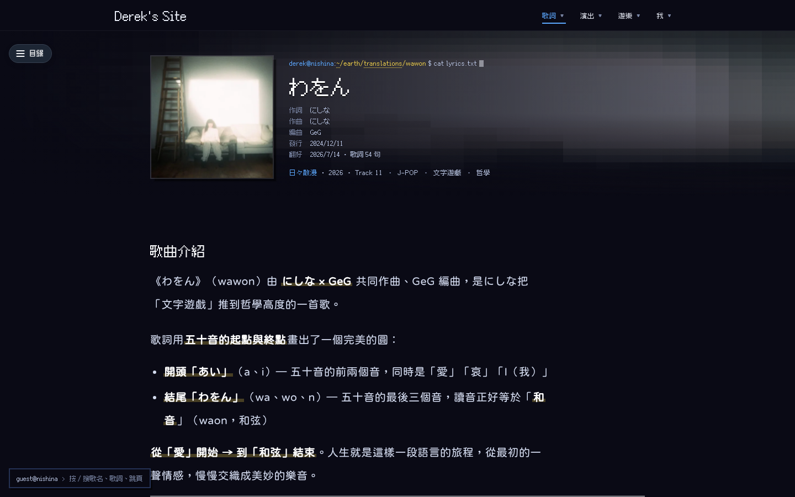
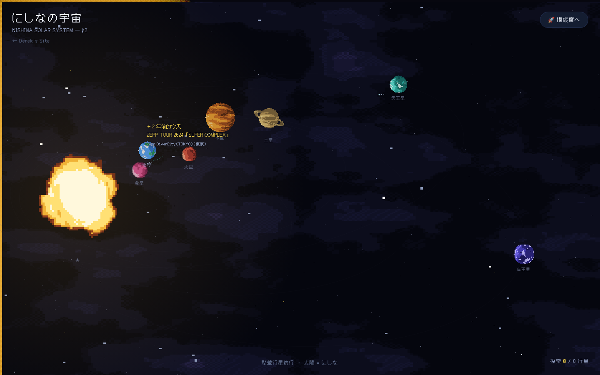
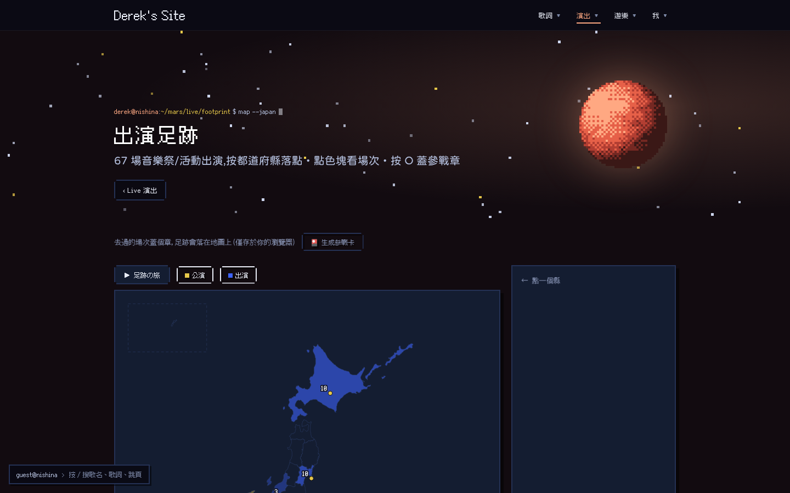
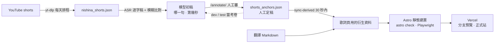

# NCA — にしな 歌詞翻譯與資料站

**把日本歌手にしな的 YouTube shorts 對上歌詞: 影片唱到哪一句, 中文翻譯就亮到哪一句。**

正式站: **https://nca-red.vercel.app** · 這個站怎麼運作 (數字每次 build 自動更新): [/projects/how-nca-works/](https://nca-red.vercel.app/projects/how-nca-works/)

| | |
|---|---|
|  |  |
|  |  |

## 這是什麼

我是にしな的歌迷。一開始只是想把她的歌翻成中文, 後來發現官方頻道有上千支演唱會的 shorts,
就想: 如果歌詞頁可以直接放現場影片, 而且跟著唱到的那一句走, 聽歌的時候就能同時看到現場跟歌詞。

現在這個站有 50 首歌的日 / 羅馬拼音 / 中文對照翻譯、上千支對好時間點的現場片段、
可以從頭到尾「接」成一首的完整 Live、歷年巡演 setlist、出演足跡地圖、歌詞的詞彙與意象分析,
外面包一層像素風的宇宙世界觀。

## 架構



- **資料**: Python 管線 + GitHub Actions 定期抓、算, 結果以 JSON commit 回 repo
- **人工審核**: 自己寫的標注器 (`/annotate/`), 看著模型的初稿改, 存檔直接 commit 回 repo, 手機也能審
- **網站**: Astro 7 純靜態輸出, 所有數字在 build 時從 JSON 算; Vercel 部署, 每個分支都有預覽網址
- **品質**: CI 跑型別檢查、建置、鏡像檔一致性檢查, 加上 Playwright 每頁桌機 / 手機冒煙測試

## 為什麼這樣選

- **純靜態, 不要後端**: 資料量不大 (幾 MB 的 JSON), 更新頻率是「每天一次」等級。靜態站沒有伺服器要顧,
  每一次資料變動都有 git 紀錄, 出錯可以直接回到上一版。
- **Astro**: 頁面大多是內容, 只有少數互動 (播放器、地圖、扭蛋)。Astro 預設不送 JS, 需要互動的地方才加,
  content collection 的 schema 也幫我擋掉翻譯檔的格式錯誤。
- **模型打草稿、人來審**: 演唱會音訊很難辨識, 模型的初稿目前大約一半可以直接用。與其追求全自動,
  不如讓模型把「從零開始標」變成「看一眼、改幾格」; 我審完的定稿再分成 dev / test 回頭評估模型。
- **GitHub Actions 當排程器**: 抓資料、重算衍生檔都是幾分鐘的批次工作, 用 Actions 免費又跟 repo 綁在一起;
  每支 workflow 只 commit 明確列出的檔案, 也不 push 自己的觸發路徑, 不會互相觸發成迴圈。
- **像素風**: 一方面是喜歡, 一方面是字型子集化之後很輕 — 全站中日文像素字只收用得到的幾千字。

## 怎麼跑起來

```bash
git clone https://github.com/dereknir/NCA.git && cd NCA
npm install
npm run dev        # http://localhost:4321
```

需要 Node 22。資料都已經在 repo 裡, 不用跑 Python 也能開站; 要重算資料再看下面的「資料管線」。

---

## 開發者資訊

### 站點地圖

| 路徑 | 內容 | 來源 |
|---|---|---|
| `/translations/` | 50 首歌的日/羅馬拼音/繁中對照翻譯, 歌詞頁內嵌 Live Stage (shorts 影片 + 歌詞逐句同步) | `src/content/translations/*.md` + `src/data/shorts_by_song.json` |
| `/lyric-universe/` | 歌詞宇宙: 意象 / 色彩 / 詞彙統計 | `scripts/analyze_lyrics.py` |
| `/kwic/` | 歌詞索引 (KWIC, 依 lemma 倒排) | `scripts/build_kwic.py` |
| `/star-map/` | 歌詞星圖: 句向量 → UMAP 2D → 星座分群 | `scripts/embed_star_map.py` (本機跑) |
| `/setlists/` | 歷年巡演曲目清單 | `scripts/scrape_setlists.py` |
| `/live/` → `timeline` `concerts` `footprint` | 年表 / 公演史 / 出演足跡 (日本地圖) | `live/inject.py` + `live/data/*.json` |
| `/extras/` | 音樂之外的 shorts 分類展示 | `src/data/shorts_extras.json` |
| `/gacha/` | 歌詞卡扭蛋 (canvas 像素卡) | `public/gacha/` |
| `/galaxy/` | 太陽系 hub (shader 行星, 各頁入口) | `public/galaxy/` |
| `/annotate/` | **內部工具**: shorts 歌詞時間點標注器 | `public/annotate/index.html` |
| `/admin/` | **內部工具**: 透過 GitHub API 編輯內容的靜態後台 | `src/pages/admin/` |
| `/diary/` `/projects/` `/about` | 日記、作品集、關於 | `src/content/` |

### 技術

- **Astro 7** (static output) + **Tailwind CSS 4** + MDX; Node 22; `astro check` 做型別檢查
- 像素字型: fusion-pixel (12/10/8px) 與 jf open 粉圓, 依全站字集子集化成 woff2 (`scripts/build_pixel_fonts.py`)
- Python 3.11 資料管線 (`requirements.txt`; 重型 ML 另見 `requirements-ml.txt`)
- 部署: Vercel 讀 `develop` 分支, `vercel.json` 指定 framework preset (astro)、build/dev 指令與輸出目錄

### 本地開發

```bash
npm install
npm run dev        # http://localhost:4321
npm run build      # 靜態輸出到 dist/
npm run check      # astro check (TS / content schema)
npm run test:e2e   # build + Playwright 冒煙測試 (每頁 1440 / 390 各開一次; E2E_ALL=1 跑全部歌)

pip install -r requirements.txt      # 資料管線用
python scripts/check_sync.py         # 驗證 public/annotate/ 鏡像與來源一致 (CI 也跑)
```

### 目錄結構

```
src/
  content/translations/*.md   歌詞翻譯 (source of truth; frontmatter schema 在 src/content.config.ts)
  content/diary, projects     日記、作品集
  pages/                      Astro 路由; components/ layouts/ styles/
  data/*.json                 build 時讀的衍生資料 (shorts_by_song, setlists, kwic_index, star_map …)
  config.ts                   站名、導航、社群連結
public/
  annotate/ gacha/ galaxy/ kwic/ lyric-universe/ star-map/ live/   不經 Astro 的靜態子站 (多為腳本注入資料的單檔 HTML)
  covers/ fonts/ og/          封面圖、字型子集、OG 分享圖
data/                         管線中繼檔 (lyrics.json, nishina_shorts*.json, site_charset.txt, vectors_q8.json)
scripts/                      Python 管線 + 注入用 HTML 模板
annotation/                   shorts 標注工作區 (HANDOFF.md 有完整背景)
live/                         live 三頁的模板、資料、inject.py、eplus 哨兵 (DATA-REFRESH-POLICY.md)
docs/                         設計討論與規格 (STAGE-SPEC.md 等)
.github/workflows/            六支 Actions (見下)
```

### 資料管線

#### 歌詞 (md → 衍生資料)
```
src/content/translations/*.md
  └─ scripts/export_lyrics_json.py  → data/lyrics.json (+ 鏡像 public/annotate/lyrics.json)
       ├─ scripts/analyze_lyrics.py   → src/data/lyric_universe.json + public/lyric-universe/index.html
       ├─ scripts/build_kwic.py       → src/data/kwic_index.json + public/kwic/index.html
       └─ scripts/embed_star_map.py   → src/data/star_map.json + public/star-map/index.html (本機, e5 模型)
scripts/build_site_charset.py → data/site_charset.txt → scripts/build_pixel_fonts.py → public/fonts/
```
一鍵: `python scripts/refresh_data.py` (export → analyze → kwic)。

#### Shorts (YouTube → 標注 → 歌詞頁)
```
yt-dlp (@nishina__official/shorts) → data/nishina_shorts_raw.jsonl (gitignored)
  └─ scripts/clean_shorts.py       → data/nishina_shorts.json
       ├─ scripts/classify_shorts.py             → data/nishina_shorts_classified.json (花絮分類)
       ├─ annotation/build_annotation_queue.py   → annotation/annotation_queue.json (+ 鏡像 public/annotate/)
       └─ scripts/build_recent_new.py            → annotation/recent_new_shorts.json (日報用)
annotator (/annotate/) 人工或 scripts/auto_annotate.py (ASR, 本機跑; scripts/eval_align.py 離線評估對齊) 標時間點
  └─ annotation/shorts_anchors.json  (source of truth, annotator 直接 push 到 GitHub)
       ├─ scripts/import_anchors.py        → src/data/shorts_by_song.json / shorts_extras.json / shorts_tours.json
       └─ scripts/build_gacha_live_pool.py → public/gacha/live_pool.json
```

#### Live 資料
`live/data/*.json` (news / events / tours / setlists 連結 / 出演系列 / 日本地圖) → `live/inject.py`
→ `public/live/{timeline,concerts,footprint}/index.html` + `public/live/events.json` + `public/annotate/appearances.json`。
更新政策與各資料源的抓取頻率見 `live/DATA-REFRESH-POLICY.md`。

### GitHub Actions

| Workflow | 觸發 | 做什麼 |
|---|---|---|
| `ci.yml` | 每次 push / PR | `check_sync.py` → `npm ci` → `astro check` → `astro build` (唯讀) |
| `e2e.yml` | 每次 push / PR | build → Playwright 冒煙測試 (console error / 橫向捲動 / 主要區塊; 外部請求擋掉, 唯讀) |
| `scrape-shorts.yml` | 每日 03:00 台北 / 手動 | yt-dlp 抓 shorts → 全部衍生檔 → eplus / 官方 news 哨兵 → live 重建 → commit → 日報 email |
| `sync-derived.yml` | push `annotation/shorts_anchors.json` | annotator 存檔後 30 秒內重生 shorts_by_song / extras / gacha live pool |
| `refresh-lyric-data.yml` | push `src/content/translations/**.md` | lyrics.json → 歌詞宇宙 / KWIC → 字型子集重生 |
| `rebuild-live.yml` | push `live/data/**.json` 或模板 | `inject.py` 重建 live 三頁 |

資料 workflow 都只 commit 明確列出的衍生檔, 且從不 push 自己的觸發路徑, 不會互相迴圈。

### 相關文件

- `annotation/HANDOFF.md` — shorts 標注系統的背景、格式與操作
- `live/DATA-REFRESH-POLICY.md` — 外部資料源的抓取原則 (robots、頻率、停手條件)
- `live/MANIFEST.md` — live 頁與宇宙 hub 的檔案清單
- `docs/STAGE-SPEC.md` — 歌詞頁 Live Stage 的實作規格
- `public/gacha/README.md` — 扭蛋原型說明

### 素材與致謝

行星 shader 改編自 Deep-Fold「PixelPlanets」(MIT) 的 Unity 移植版 hmcGit/UniPixelPlanet (MIT);
像素字型 fusion-pixel-font (OFL-1.1); 內文字型 jf open 粉圓 (OFL-1.1) 與 DotGothic16 (OFL-1.1);
日本地圖 dataofjapan/land (Natural Earth, 公有領域)。歌詞與影片版權屬原權利人, 影片一律以 YouTube 官方 IFrame 嵌入。
